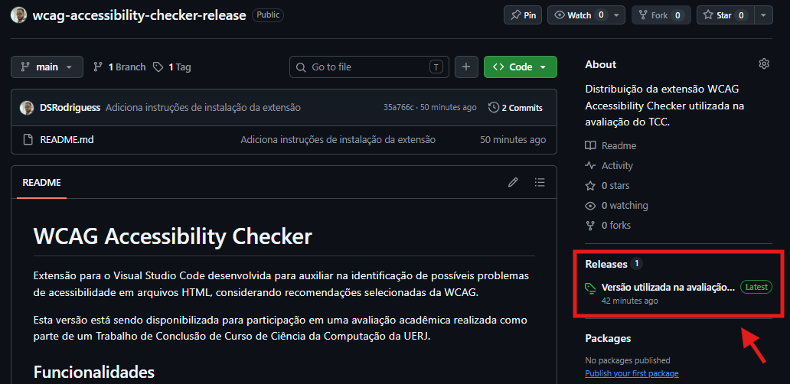
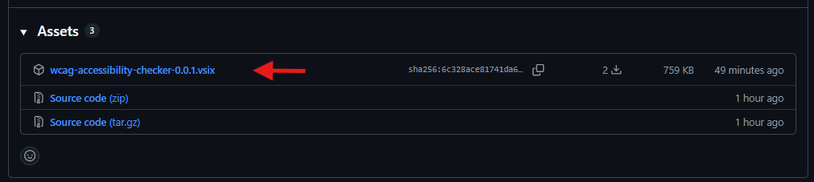
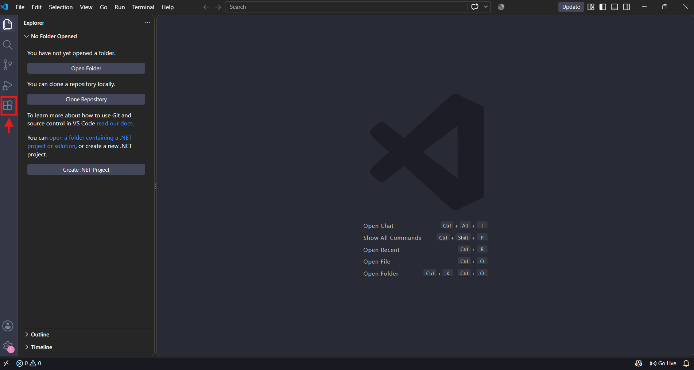
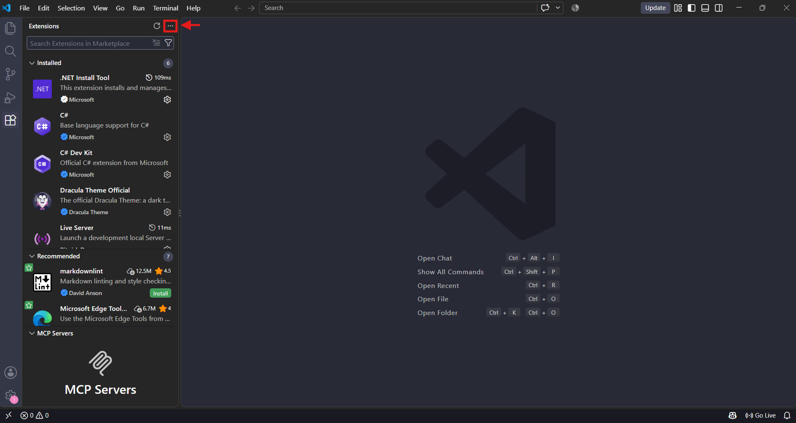
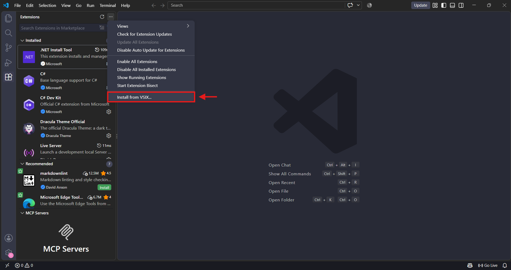

# Instruções para realização da atividade

Siga as etapas abaixo na ordem apresentada.

## 1. Baixar a extensão

1. Acesse o repositório da extensão pelo link abaixo:

   [Link da extensão](https://github.com/DSRodriguess/wcag-accessibility-checker-release)

2. Acesse a seção Releases do repositório.

3. Localize a versão indicada para esta avaliação.

4. Baixe o arquivo com a extensão `.vsix`.

Exemplo de nome do arquivo:

`wcag-accessibility-checker-0.0.1.vsix`

Não é necessário abrir ou descompactar o arquivo `.vsix`.

## 2. Instalar a extensão no Visual Studio Code

1. Abra o Visual Studio Code.
2. Acesse a aba Extensions na barra lateral.

3. Na parte superior da aba Extensions, selecione o menu de ações representado pelo ícone de três pontos.

4. Selecione a opção `Install from VSIX...`.

5. Localize o arquivo `.vsix` que foi baixado.
6. Selecione o arquivo e aguarde a conclusão da instalação.
7. Caso o Visual Studio Code solicite, selecione `Reload` para
   recarregar o editor.

## 3. Baixar o arquivo da atividade

1. Retorne ao repositório da atividade.
2. Clique no botão `Code`.
3. Selecione `Download ZIP`.
4. Extraia o arquivo ZIP para uma pasta do seu computador.
5. Não altere o arquivo HTML antes de iniciar a atividade.

## 4. Abrir a atividade

1. No Visual Studio Code, acesse `File > Open Folder`.
2. Selecione a pasta extraída.
3. No explorador de arquivos do Visual Studio Code, abra:

   `atividade/index.html`

4. Aguarde a extensão concluir a análise do arquivo.

## 5. Abrir a aba Problems

Para visualizar os diagnósticos:

1. acesse `View > Problems`; ou
2. utilize o atalho `Ctrl + Shift + M`.

A aba Problems deverá mostrar os possíveis problemas de acessibilidade identificados pela extensão.

Caso nenhum diagnóstico seja exibido:

1. confirme que o arquivo `index.html` está aberto;
2. confirme que a extensão está instalada e habilitada;
3. feche e abra novamente o arquivo;
4. utilize o comando `Developer: Reload Window` no Visual Studio Code.

## 6. Realizar a tarefa

Utilizando os diagnósticos apresentados na aba Problems:

1. leia as mensagens geradas pela extensão;
2. selecione os diagnósticos para localizar os trechos correspondentes;
3. analise os problemas indicados;
4. altere o código HTML para corrigir os problemas que considerar necessários;
5. utilize os Quick Fixes quando estiverem disponíveis;
6. salve o arquivo após realizar as alterações.

Não é necessário corrigir problemas que não tenham sido apresentados pela extensão.

Durante a atividade, não utilize ferramentas adicionais de análise de acessibilidade, como Lighthouse, axe DevTools ou WAVE.

## 7. Utilizar os Quick Fixes

Quando uma correção automática estiver disponível:

1. posicione o cursor sobre o trecho indicado;
2. selecione o ícone de lâmpada; ou
3. utilize o atalho `Ctrl + .`;
4. leia a sugestão apresentada;
5. aplique a sugestão caso a considere adequada;
6. revise o resultado após a aplicação.

A utilização de um Quick Fix é opcional.

## 8. Finalizar a atividade

Ao final:

1. confira se o arquivo foi salvo;
2. não publique o código corrigido no GitHub;
3. acesse o questionário de avaliação pós-uso:

   [Acessar o questionário de avaliação pós-uso](https://forms.gle/jxExNCb2Ca7bo59P9)

4. responda considerando somente a experiência que teve durante a
   atividade.

## Problemas técnicos

Caso não consiga instalar a extensão ou executar a atividade, registre a dificuldade no questionário de avaliação pós-uso.

Não há qualquer prejuízo caso você não consiga concluir a atividade.
